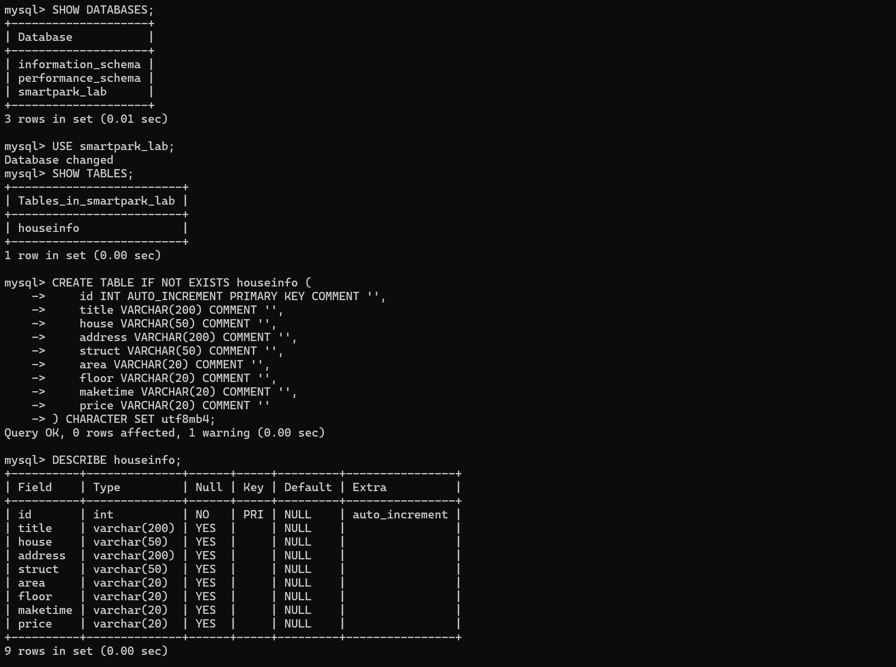
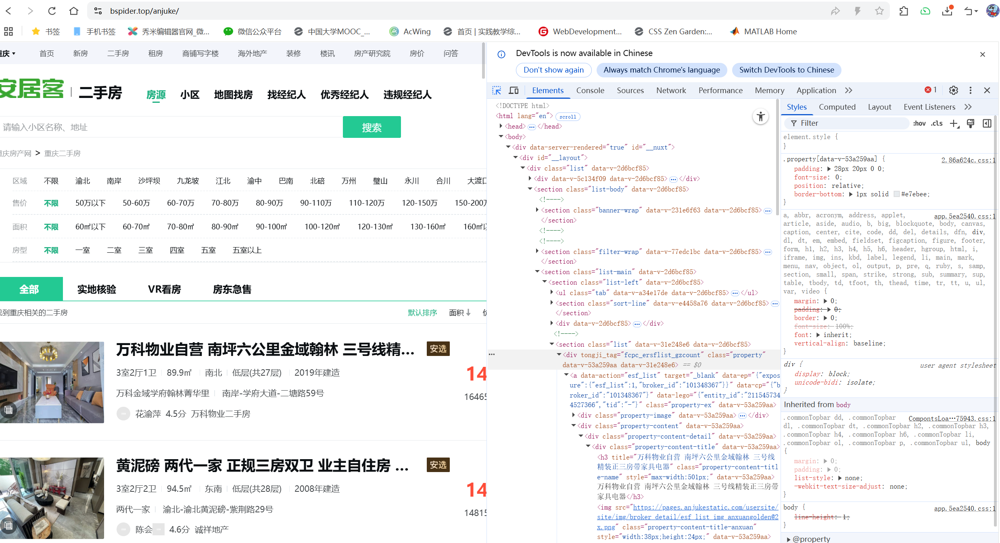
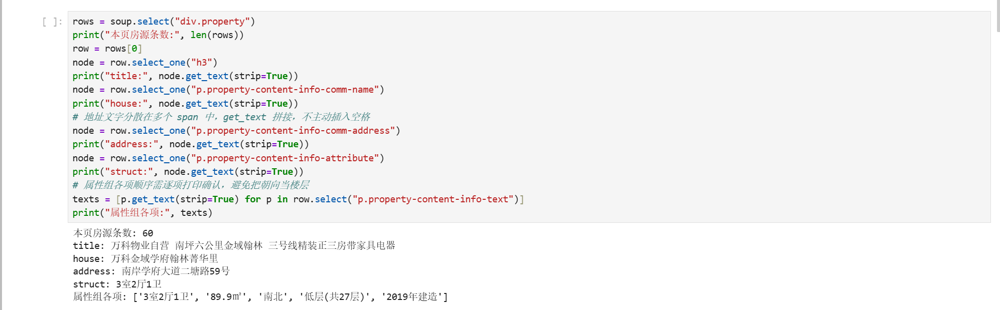
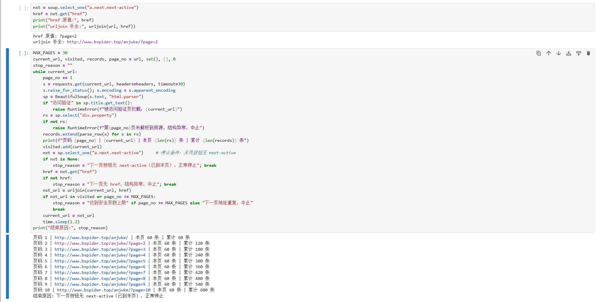
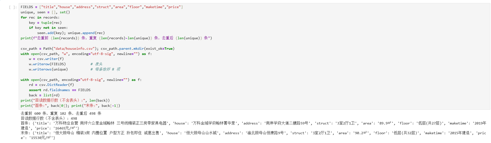
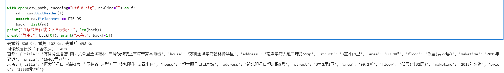
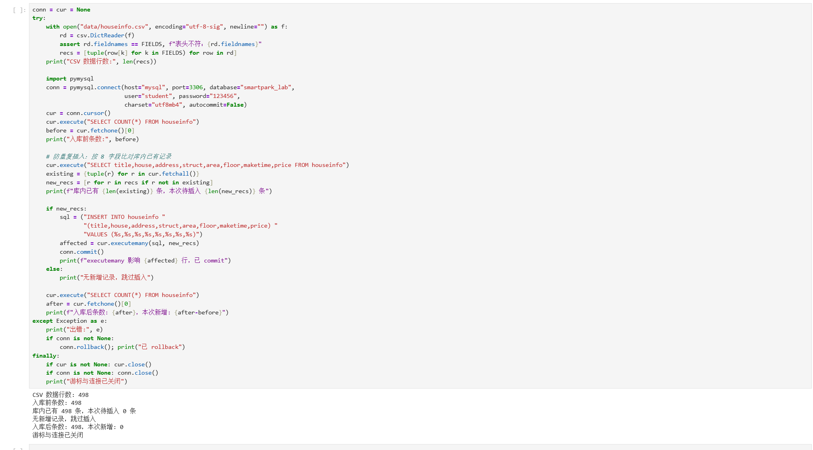
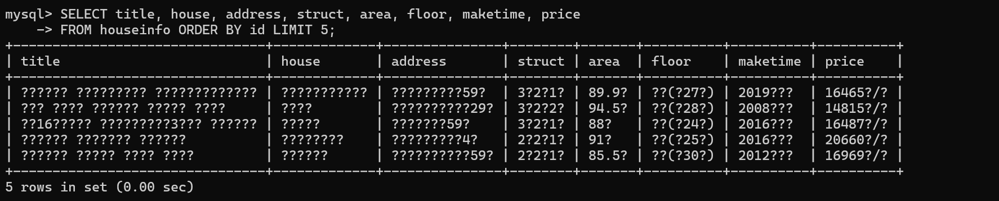
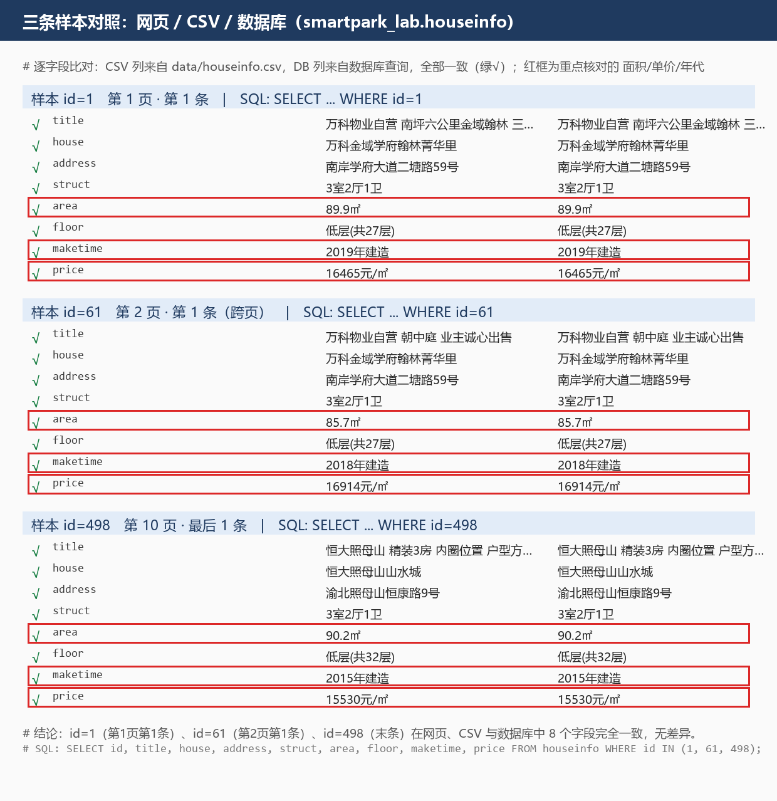

# 实验二报告：房源采集与 MySQL 存储

| 项目          | 内容                                                                                                                                                       |
| ----------- | -------------------------------------------------------------------------------------------------------------------------------------------------------- |
| 班级          | 数据1241                                                                                                                                                   |
| 姓名          | 沈昊辉                                                                                                                                                      |
| 学号          | 112404260123                                                                                                                                             |
| 实验日期        | 2026-10-27                                                                                                                                               |
| GitHub 仓库链接 | <https://github.com/05justin-hub/bigdata-collection-labs-112404260123>                                                                                   |
| 源码文件名       | `lab02/anjuke.ipynb`（另附脚本 `lab02/anjuke.py`、`lab02/load_mysql.py`）                                                                                       |
| 数据库与表       | `smartpark_lab.houseinfo`                                                                                                                                |
| 数据来源        | 在线教学站（<http://www.bspider.top/anjuke/）>                                                                                                                  |
| 访问时间及结果     | 2026-10-27 14:19 起访问。首次用 `User-Agent: Mozilla/5.0` 请求，返回 200 但内容为「访问验证-安居客」反爬页；改用完整 Chrome UA + Referer 后成功获取真实列表页（HTTP 200，标题「重庆二手房房产网…」），随后 10 页全部采集成功 |
| 快照文件来源与文件名  | 不适用（本次在线采集成功）                                                                                                                                            |

> 说明：截图放在 `images/` 中，红框标出关键代码或关键输出，每项附 2—3 句解释。本次全部实验步骤均已完成。

---

## 第一阶段：MySQL Docker 更新与启动

- **本次是否需要更新**：已完成更新（L05 增量更新包此前已复制到 `D:\BigDataCourse`，包含 `start-mysql.bat`、`mysql-console.bat`、`l05-mysql.ps1`、`l05-mysql-fresh-volume.yaml`，使用 L05 教学数据卷）
- **更新或启动遇到的问题**：无。启动 Docker Desktop 后运行 `start-mysql.bat` 显示 `[PASS] L05 MySQL healthy`；入库脚本在课程容器网络内运行（等价于在 JupyterLab 中执行，host=`mysql`）

### 启动环境与建表

依次使用 `start-course.bat`、`start-mysql.bat`、`mysql-console.bat` 启动课程环境、数据库和 MySQL 终端。

**图 1** `USE smartpark_lab` 后 `SHOW TABLES` 确认 `houseinfo` 表存在；`DESCRIBE houseinfo` 显示 9 列结构——`id` 为 `int` 自增主键（PRI / auto_increment），其余 8 列为 VARCHAR。图中还包含建表 SQL 与 `Query OK`，说明表是本次实验按模板新建的。注：截图时数据已入库；实验开始前 `COUNT(*)` 为 0。

**说明：当前使用哪个数据库？`id` 和 8 个房源字段分别保存什么？**

答：使用 `smartpark_lab` 数据库。`houseinfo` 表中 `id` 是自增长主键，由数据库自动生成；其余 8 列保存采集结果：`title` 标题、`house` 楼盘名称、`address` 地址、`struct` 户型、`area` 建筑面积、`floor` 楼层、`maketime` 建造年代、`price` 每平方米单价，字符集 `utf8mb4` 以支持中文和 `㎡` 等符号。

---

## 第二阶段：房源采集与 CSV 数据存储

### 1. 网页分析与房源解析

#### 选择器是怎样得到的

在 Chrome 中按 F12，使用 **Elements → Copy → Copy selector**，记录从完整路径到相对选择器的过程。

| 项目          | 内容                                                                                                            |
| ----------- | ------------------------------------------------------------------------------------------------------------- |
| 选择的字段       | 标题（title）                                                                                                     |
| 复制的原始选择器    | `#__layout > div > section > section.list-main > section.list-left > section:nth-child(4) > div:nth-child(1)` |
| 一条房源的父容器选择器 | `div.property`                                                                                                |
| 最终使用的相对选择器  | `row.select_one("h3.property-content-title-name")`（row 为一条 `div.property`）                                    |

**图 2** 左侧为教学站房源列表，右侧 Elements 面板展开第一条房源的 HTML：可见其父级容器节点（`property-content` / `property` 系列 class），Styles 面板同时显示了 `h3.property-content-title-name` 的样式规则。该容器同时包含标题、楼盘、地址、属性与价格，且第二条房源使用相同 class，说明 `div.property` 就是"一条房源"的稳定父容器。

**说明：删掉了哪些层级？怎样确认父容器刚好包含一条房源？**

答：删掉了从 `#__layout` 到标题之间的全部祖先层级——原始选择器里的 `section:nth-child(4)`、`div:nth-child(1)` 都是按位置选择，页面多插一个元素就会失效。确认方法：鼠标悬停在 `div.property` 节点上，页面高亮区域刚好覆盖一条房源的全部内容；再用 `soup.select("div.property")` 得到 60 条，与页面房源数一致。

#### 解析 8 个字段

**图 3** 红框部分：`rows = soup.select("div.property")` 用 `select()` 选中整页 60 条房源容器；`row.select_one("h3")` 等用 `select_one()` 在单条房源内部做相对查找。输出显示首条房源的 title / house / address / struct，以及属性组逐项打印结果 `['3室2厅1卫', '89.9㎡', '南北', '低层(共27层)', '2019年建造']`——顺序确认后才能安全区分面积、朝向、楼层和年代。

**说明：两个选择方法各用在哪里？怎样确认面积和单价没有取错？**

答：`select()` 用于整页匹配多条房源容器（返回列表）；`select_one()` 用于在每条房源内定位单个字段节点（返回第一个匹配，找不到返回 None，先判空再取文字）。面积取属性组中带 `㎡` 的项（`89.9㎡`），单价取 `p.property-price-average`（`16465元/㎡`），两者均对照网页原文核对过单位，确保没有把万元总价 `p.property-price-total`（148万）当成单价；建造年代取含"建造"的项，节点缺失时保持空字符串，不报错。

### 2. 下一页采集

| 项目                   | 内容                                                     |
| -------------------- | ------------------------------------------------------ |
| 下一页 `href` 原值        | `?page=2`                                              |
| 用 `urljoin()` 补全后的地址 | `http://www.bspider.top/anjuke/?page=2`                |
| 实际停止原因               | 明确停止——第 10 页后 `a.next.next-active` 不存在（末页按钮已禁用），循环正常结束 |

**图 4** 上半部分红框：`nxt = soup.select_one("a.next.next-active")` + `nxt.get("href")` 提取相对链接，`urljoin(url, href)` 补全为完整地址；下半部分为分页循环代码，含 `visited.add(current_url)` 与 `if nxt_url in visited or page_no >= MAX_PAGES` 的防重复 / 防死循环判断。下方日志显示页码 1—10 每页 60 条、累计 600 条，最后一行「结束原因：下一页按钮无 next-active（已到末页），正常停止」。

**说明：怎样进入下一页？怎样防止重复采集或无限循环？**

答：每页解析完后用 `select_one("a.next.next-active")` 找活动的"下一页"按钮，`get("href")` 取得 `?page=2` 这样的相对地址，`urljoin(current_url, href)` 拼成完整 URL 作为下一轮请求地址。三重保护防异常：① `visited` 集合，地址重复即中止；② `MAX_PAGES=30` 安全上限，达到只记为中止、不算采集完成；③ 末页按钮失去 `next-active` class 即正常停止。每页间 `time.sleep(1.2)` 礼貌等待。注意 `get_text()` 取到的是"下一页"三个字，链接必须用 `get("href")` 取。本次 10 页全部成功，无异常中止。

### 3. 保存 CSV

**图 5** 红框 1：按 8 字段元组去重的 `seen` / `unique` 逻辑；红框 2：`open(..., encoding="utf-8-sig", newline="")`、`writer.writerow(FIELDS)` 写表头、`writerows(unique)` 写数据。输出显示「去重前 600 条，重复 102 条，去重后 498 条」「回读数据行数（不含表头）: 498」，并用 `csv.DictReader` 回读打印了首条与末条。

**说明：8 个字段的顺序是什么？按 8 个字段完全相同去重后，保存了多少条记录？**

答：顺序为 `title → house → address → struct → area → floor → maketime → price`，与网页解析顺序、数据库表列一致。采集 600 条（教学站后 5 页与前 5 页房源大量重复），按 8 字段完全相同去重后保存 **498 条**。编码 `utf-8-sig` 保证 Excel 直接打开不乱码，`newline=""` 防止 Windows 下出现空行。

---

## 第三阶段：MySQL 数据存储

> 本阶段读取第二阶段的 `data/houseinfo.csv` 写入数据库，不重新爬取网页。连接参数：host=`mysql`（课程容器服务名）、port=`3306`、database=`smartpark_lab`、user=`student`、password=课程统一密码（不在报告中展示）、charset=`utf8mb4`、autocommit=`False`。

### 1. 读取 CSV 并入库

**图 6** 红框：`csv.DictReader` 读取 CSV，`assert rd.fieldnames == FIELDS` 校验表头，`recs = [tuple(row[k] for k in FIELDS) for row in rd]` 把每行按 8 字段固定顺序整理成元组——这保证了后面 INSERT 参数的位置一一对应。

**图 7** 红框 1：防重复插入——先 `SELECT` 库内全部 8 字段记录构成集合 `existing`，`new_recs` 只保留库中不存在的记录；红框 2：INSERT 写明 8 个列名与 8 个 `%s` 占位符，`cur.executemany(sql, new_recs)` 批量写入后 `conn.commit()`；红框 3：`except` 中 `conn.rollback()` 回滚未提交修改，`finally` 中先 `cur.close()` 后 `conn.close()`，且都先判断对象非空。本次输出「库内已有 498 条，本次待插入 0 条」正是独立重跑防重复的证据。

**说明：每条记录怎样对应 8 个参数？成功、失败时分别做什么？再次运行时怎样避免重复插入？**

答：INSERT 中 8 个列名与 8 个 `%s` 一一对应，`executemany(sql, records)` 中每条记录是按 `FIELDS` 顺序取出的 8 元组，位置对应、特殊字符由 pymysql 参数化转义，全程不用字符串拼接。成功路径：`executemany` → `conn.commit()` 提交事务，之后另一终端才能查到新数据；失败路径：进入 `except` 执行 `conn.rollback()`，撤销本次事务中未提交的修改（回滚不影响已提交数据）。再次运行时先查询库内已有 8 字段记录组成集合，过滤后再插入，只插不存在的记录，不清空表。

### 2. 核对结果

#### 查询条数和样本

**图 8** 在 MySQL 终端执行 `SELECT title, house, address, struct, area, floor, maketime, price FROM houseinfo ORDER BY id LIMIT 5;` 的结果，`5 rows in set` 确认数据已入库。终端默认字符集下中文显示为 `?`（数值与单位仍可辨认，如 `89.9?` 即 `89.9㎡`、`16465?/?` 即 `16465元/㎡`），属于终端显示问题；改用 `--default-character-set=utf8mb4` 连接后中文正常显示（见图 9 的逐字段核对）。

| 项目                         | 实际结果            |
| -------------------------- | --------------- |
| 成功采集页数                     | 10              |
| 采集记录数（去重前）                 | 600             |
| 完全相同的重复记录数                 | 102             |
| CSV 数据行数（不含表头）             | 498             |
| 入库前条数                      | 0               |
| 入库后条数 / 本次新增条数             | 498 / 498       |
| 关闭上次程序后，同批数据独立重跑的条数 / 新增条数 | 498 / 0         |
| 是否采集完整；未完成的原因              | 完整；末页按钮已禁用后正常停止 |

**说明：首次入库后的条数应等于去重后的 CSV 数据行数，8 个字段的内容也应一致。若不一致，说明原因。**

答：一致。首次入库后 498 条 = CSV 数据行数 498；关闭程序后独立重跑，脚本比对库内记录后插入 0 条，条数保持 498，防重复逻辑有效。

#### 逐条核对

**图 9** 选取三条样本，将 CSV 数据与数据库查询结果（`SELECT ... WHERE id IN (1, 61, 498)`）逐字段比对：8 个字段全部一致（绿√），红框为重点核对的**面积、单价、年代**——单位与文字完全相同。图底部附结论与所用 SQL。

| 项目             | 样本 1         | 样本 2           | 样本 3             |
| -------------- | ------------ | -------------- | ---------------- |
| 网页位置           | 第 1 页第 1 条   | 第 2 页第 1 条     | 第 10 页最后 1 条     |
| CSV 行号 / 库内 id | 第 1 条 / id=1 | 第 61 行 / id=61 | 第 498 行 / id=498 |
| 核对结果           | 8 字段一致       | 8 字段一致         | 8 字段一致           |

**核对结论及差异**：三条样本在网页、CSV、数据库三方完全一致，无差异。

---

## 问题与解决

- **遇到的问题、处理方法及结果**：
  1. 首次用 `User-Agent: Mozilla/5.0` 请求教学站，HTTP 200 但正文是「访问验证-安居客」反爬页。解决：改用完整 Chrome UA + Referer 请求头，并在代码中加入验证页检测（标题含"访问验证"即报错中止，不转采真实安居客），之后 10 页全部正常。
  2. 教学站第 6—10 页与前 5 页房源大量重复，共 102 条完全重复记录。解决：按 8 字段去重后入库，并记录去重前后条数（600 → 498）。
  3. MySQL 容器未映射宿主机端口，宿主机无法直连 `host=mysql`。解决：把 CSV 和入库脚本挂载进课程容器网络运行（等价于在 JupyterLab 中执行），连接、入库、重跑验证均成功。
- **尚未解决的问题、未完成的步骤**：无

## 思考题

**1. 本次怎样实现下一页采集？结合自己的代码说明。**

答：每页解析完后用 `soup.select_one("a.next.next-active")` 找到活动的"下一页"按钮，`nxt.get("href")` 取得 `?page=2` 这样的相对地址，再用 `urljoin(current_url, href)` 拼成完整地址（如 `http://www.bspider.top/anjuke/?page=2`）作为下一轮请求的 URL。停止条件是末页按钮不再带 `next-active` class（`select_one` 返回 None 即正常结束）；另设 `MAX_PAGES=30` 安全上限和已访问集合，地址重复或超限都中止，防止无限循环。注意 `get_text()` 取到的是"下一页"三个字，链接必须用 `get("href")` 取。

**2. 旧代码把 out_list 定义在全局。你把结果列表放在哪里？为什么？**

答：我把 `records` 放在分页循环所在的函数局部作用域里，解析函数 `parse_row()` 只接收一条 `row` 并返回 8 元组，不直接修改全局列表。这样数据流向清晰（解析 → 收集 → 去重 → 保存，各步骤边界明确），函数不依赖外部状态、可单独测试；也避免多次运行时全局列表残留旧数据导致重复采集。

**3. 你怎样获取建造年代？节点缺失或顺序改变时，怎样处理？**

答：建造年代在属性组 `p.property-content-info-text` 中，形如"2019年建造"。我不按固定下标取值，而是遍历属性组各段文字，用内容特征匹配：含"建造"的项是年代，含"㎡"的是面积，含"层"的是楼层（先打印属性组全部项确认过顺序）。这样某一项缺失或顺序改变都不会错位取值；找不到年代时 `maketime` 保持初始化的空字符串，符合"缺失时填空字符串"的要求。

## 提交检查

- [x] 实验一原仓库的 `lab02/` 中已有源码、CSV、报告和真实截图。
- [x] 截图清楚，关键代码已框出，每项附有个人解释。
- [x] GitHub 上能打开文件和图片，未上传个人账号密码、`.env` 或教师答案。（2026-10-27 已上传）
- [ ] 未完成项已如实说明；学习通只交原仓库链接。（待提交学习通后勾选）

如使用 AI，简述它帮助了什么，以及自己修改、运行和核对了什么：

> AI 辅助搭建了采集/入库代码框架，并协助排查反爬（改用浏览器 UA）与容器网络连接问题；本人在 JupyterLab / MySQL 终端中实际运行了全部代码，核对了网页、CSV 与数据库的三方样本一致性，重跑验证了防重复逻辑，并确认报告中的所有数据与运行输出一致。
