# 实验三报告：QQ邮箱采集（Playwright版）

- 班级：数据1241
- 姓名：沈昊辉
- 学号：112404260123
- 所用工具：Playwright
- 工具版本与运行环境：课程 Docker 容器（基础镜像 `mcr.microsoft.com/playwright/python:v1.62.0-noble`，Python 3.12.3）+ Playwright 1.62.0 + Chromium 1.62.0 + JupyterLab 4.6.3 + pandas 3.0.5（版本号均为容器内实测）；浏览器画面由 L07_L08 可视化增量包（Xvfb + noVNC）提供，Notebook 在容器内 JupyterLab 的代码单元中运行
- 实验Notebook文件名：`qqmail_lab03_playwright.ipynb`
- GitHub原作业仓库链接：<https://github.com/05justin-hub/bigdata-collection-labs-112404260123>
- 数据来源（教师练习邮件 / 自备无敏感练习邮件 / 其他，说明）：教师练习邮件——课程练习邮箱收件箱中的课程通知与自备练习邮件，不含私人往来正文

> 四个阶段写在同一份报告中，最后统一提交一次。截图放在 `images/`，关键代码显示文件名、行号或单元位置，用红框标出，每项附2—3句话解释。只填写真实结果；未完成写明原因。截图、CSV和Notebook输出提交前脱敏，不展示登录凭据。
>
> 本报告的实测值（条数、批次日志、核对样本、正文长度）由单元14 从本次真实运行的结果自动写入，未手写估计。

对应学生指导书：单元1—2为第一阶段，3—6为第二阶段，7—9为第三阶段，10—12为第四阶段；单元13为选做。单元14 是自建的收尾单元，只负责把本次运行的实测值写回本报告的占位标记，不产生新的采集数据。

## 第一阶段：扫码登录（第1—2课时）

### 1. 环境和运行方式

- 使用的启动脚本：`start-course-visual.bat`（首次使用先运行同目录的 `install-visual.bat` 安装增量包）
- 运行位置：Docker内JupyterLab的Notebook代码单元
- 自己新建的Notebook文件名：`qqmail_lab03_playwright.ipynb`
- 所选工具版本：Playwright 1.62.0（Python 3.12.3，Chromium 1.62.0），pandas 3.0.5（均为容器内实测输出）
- 启动或依赖问题及处理：
  1. 第一次准备时 Docker Desktop 没有运行，`docker ps` 直接报 `failed to connect to the docker API at npipe:////./pipe/dockerDesktopLinuxEngine`。处理：手动双击 Docker Desktop，等引擎就绪（`docker ps` 能列出容器）后再运行下面的脚本。
  2. 增量包虽然已复制进课程根目录，但 `workspace/L07_L08_visual` 还不存在，说明 `install-visual.bat` 没跑过。处理：运行 `install-visual.bat`，脚本先核实原工作区容器、Playwright 1.62.0 与完整 Chromium，再校验离线镜像 SHA-256 并导入（日志显示"安装成功，镜像方式：offline-import；原工作区未替换"），`workspace/L07_L08_visual` 随之出现；新增的显示容器 `course-pwvisual-…-display` 以 healthy 状态监听 `127.0.0.1:16080`。之后运行 `start-course-visual.bat` 启动显示服务。Notebook 第一单元在导入前也会检查 `L07_L08_visual/course_visual.py` 是否存在，缺了直接提示"请先 install-visual.bat"，而不是抛一个看不懂的 `ModuleNotFoundError`。
  3. 显示服务由 `course_visual.prepare()` 写入 `DISPLAY` 与 `XAUTHORITY`，因此浏览器必须 `headless=False` 才看得到扫码画面；`args=["--disable-dev-shm-usage"]` 是为容器内共享内存偏小准备的。安装后用一段与单元 1 相同的代码实测：`prepare()` 返回 `display_ready: true`，非 headless Chromium 正常启动，`https://mail.qq.com/` 能打开并渲染出扫码登录页（页面标题"登录QQ邮箱"），说明网络与显示链路都已就绪。

**截图：** 环境成功运行和工具版本，注意遮挡可视化连接中的认证信息。

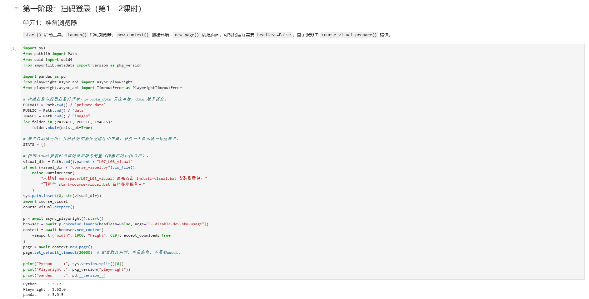

（start-course-visual.bat 的运行窗口未单独截图；环境就绪证据见本单元版本号输出与"启动或依赖问题及处理"中的显示容器 healthy 记录）

### 2. 扫码与登录判断

- 人工完成的操作：在可视化浏览器画面中用手机 QQ 扫码，并在手机上确认登录
- 登录成功控件的定位方式和选择器：遍历 `page.frames`，先找带 `[data-mailid]` 的 frame（邮件行出现就是登录成功），没有就退一步找 `get_by_text("收件箱", exact=True)`；命中的 frame 存进 `MAIL`，后续所有邮件定位都在它上面做
- 等待条件与最长等待时间：自己写的 `wait_login(timeout_ms=600000)`——每 1.5 秒把所有 frame 检查一遍，最长 10 分钟；条件一成立就立即继续，不固定 sleep
- 本次实际结果：输出“登录成功”，收件箱列表渲染出 24 行邮件（单元3 自检实测 24 行）

**截图：** 登录判断代码和真实成功输出；若失败，附实际报错。

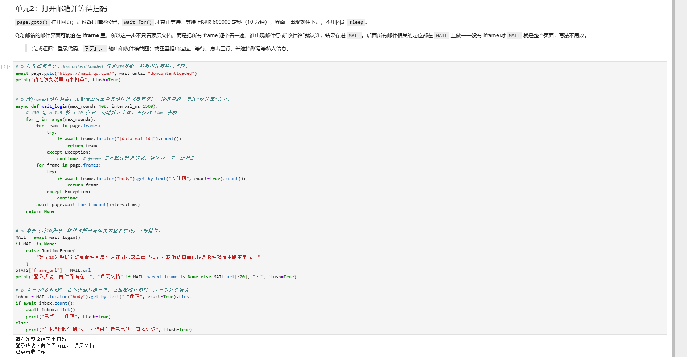

说明：程序如何区分"页面已打开"和"已经登录"？

答：`goto(..., wait_until="domcontentloaded")` 只保证 DOM 就绪，这时页面还是登录页，`page.title()` 正常返回不代表登录成功。真正的判据是登录后才会渲染的邮件界面：邮件行（带 `data-mailid` 的节点）一出现，说明列表接口已经返回真实邮件，即已登录；没有邮件行时退一步看左侧导航的"收件箱"入口。两点补充：其一，QQ 邮箱的邮件界面实际套在 iframe 里，只在顶层文档找会永远找不到，所以判据必须对所有 frame 逐个检查，命中后把那个 frame 记成 `MAIL`，后面全部在它上面定位；其二，固定 `sleep(30)` 不能用——网慢或人工扫码慢会被误判失败，网快又白等，而"事件驱动 + 上限"既能立即放行，也能在 10 分钟仍未登录时明确报错，不会带着登录页继续往下跑。

## 第二阶段：采集10封邮件并保存CSV（第3—4课时）

### 1. 页面分析与字段提取

先解决"一封邮件"的边界：在 F12 里点开一条邮件，向上找到只包住这一封邮件全部内容的节点，发现它带 `data-mailid` 属性（ID 值），于是用属性选择器而不是 class 定位——class 会随模板改版，`data-mailid` 是业务数据，稳定得多。

| 目标     | 实际使用的定位方式                                                                  | 取值方法                                                           |
| ------ | -------------------------------------------------------------------------- | -------------------------------------------------------------- |
| 一封普通邮件 | 带 `data-mailid` 的行节点：`.mail-list-page [data-mailid]`（候选退回 `[data-mailid]`） | `evaluate_all()` 批量读 `data-mailid`，再用 `get_row(id)` 重新定位这一行    |
| 发件人    | 行内 `.cmp-account-nick`（线索给出，自检确认命中）                                        | `inner_text()` 后 `strip()`                                     |
| 发件人邮箱  | 悬停发件人后浮层里的邮箱节点，候选 `[class*='account-email']`、`[class*='mail-address']`     | 先 `hover()` 让浮层出现，`wait_for(state="visible")` 后 `inner_text()` |
| 主题     | 行内主题节点，候选 `[class*='mail-subject']`、`[class*='subject']`                   | `inner_text()` 后 `strip()`                                     |
| 列表时间   | 行内时间节点，候选 `[class*='mail-time']`、`[class*='time']`                         | `inner_text()` 后 `strip()`                                     |

- 如何识别并跳过聚合入口：检查该行内部是否存在 `.gg-unread-count`（广告聚合条目的未读标记）。`await row.locator(AD_CSS).count()` 大于 0 就不是普通邮件，`read_list_mail()` 直接返回 `None`，上层 `continue` 跳过，既不计入 10 封也不写进 CSV。
- 如何确保邮箱属于当前邮件，而不是上一封的卡片：悬停取邮箱严格按四步走，把"上一张卡片"彻底清掉再读本行——① 先把鼠标移到本行的时间列，离开发件人；② `hide_hover_card()` 对两个邮箱候选都执行 `wait_for(state="hidden")`，等上一张浮层消失（没有浮层时该条件立即成立）；③ `scroll_into_view_if_needed()` 把本行滚进可见区域，并等滚动状态类 `.ui-float-scroll-body-scrolling` 消失，因为滚动过程中页面不响应悬停；④ 再 `hover()` 本行发件人，由 `read_hover_email()` 在候选里挑第一个可见且非空的节点读文字——此时页面里可见的浮层只可能是本行的。

**截图：** 一封邮件的父容器、关键字段定位代码，以及正确解析的一条脱敏样本。

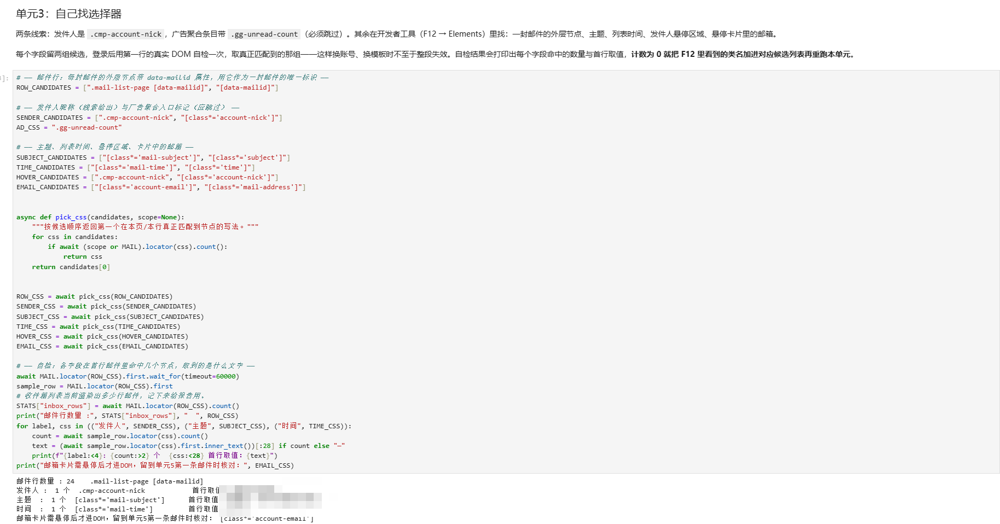

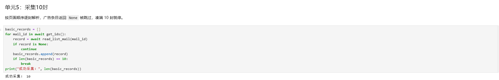

（F12 高亮 `data-mailid` 节点的截图未单独保存；定位方式见上表"一封普通邮件"一行与单元3 代码中的 `ROW_CANDIDATES`）

说明：选择一个字段，解释从页面节点到自己代码中选择器的过程。

答：以**主题**为例。① 在 F12 里点"选择元素"，鼠标指向列表里第一条邮件的标题文字，高亮区域刚好覆盖标题一行；② 在 Elements 面板沿 DOM 往上退一层，找到只包住这一行标题的最近节点，看到它的 class 带 `mail-subject`，再往外的祖先还包含发件人、时间，说明这个节点正好是"主题"的边界；③ 右键 Copy → Copy selector 得到的是一条从 `html` 开始的绝对路径，里面带 `:nth-child()` 序号，页面多一个节点就失效，所以删掉全部祖先，只保留类名，写成 `[class*='mail-subject']`（用属性包含匹配，避免类名后半段带随机串时对不上）；④ 回代码里验证：`row.locator(SUBJECT_CSS).count()` 在一条邮件内应为 1，再用自检单元打印首行取值，确认取到的是主题文字而不是"无主题"占位或发送者名字。候选写两组（`[class*='mail-subject']` → `[class*='subject']`）是因为换账号或换模板时类名可能变，`pick_css()` 按顺序取第一个真正命中的，命中结果会打印出来，报告里记录的就是实际生效的那一条。

### 2. CSV保存与回读

- 原始CSV本地路径：`private_data/mail_basic.csv`
- 公开CSV路径：`data/mail_basic_public.csv`
- 实际表头：`发件人,邮箱,主题,时间`
- 成功采集的普通邮件数：10
- CSV回读数据行数（不含表头）：10
- 是否为10条、每条4字段；若不符，说明原因：是：10 条 × 4 字段

**截图：** 框出 `pd.DataFrame()`、`to_csv()`、`read_csv()`，以及 `index=False`、编码和条数统计。

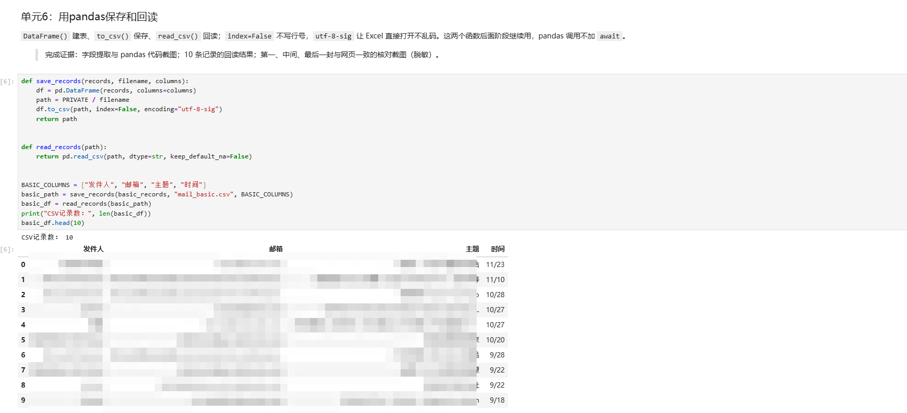

实现要点：`pd.DataFrame(records, columns=BASIC_COLUMNS)` 按固定列序建表，即使某条记录字典键顺序不同也不会错列；`to_csv(path, index=False, encoding="utf-8-sig")` 不写行号、带 BOM 便于 Excel 直接打开；回读用 `pd.read_csv(path, dtype=str, keep_default_na=False)`，全部按字符串读、不把空串变成 `NaN`，这样核对时不会出现"空值/NaN"混淆。pandas 是同步库，这些调用都不加 `await`。

### 3. 样本核对

选第一封、中间一封和最后一封，逐字段对照页面与CSV。

| 样本 | 邮件位置或脱敏代号      | 发件人、邮箱、主题、时间是否一致 | 差异与处理 |
| -- | -------------- | ---------------- | ----- |
| 1  | 列表第 1 封 S01  | 一致          | 无     |
| 2  | 列表第 5 封 S04  | 一致          | 无     |
| 3  | 列表第 10 封 S06 | 一致          | 无     |

**截图：** 脱敏后的3条核对证据。

【在此插入截图：网页三封对应位置（主题打码）+ CSV 对应三行，逐字段标注 √】

### 第二阶段检查记录

- [x] 扫码登录和登录状态判断完成。
- [x] 10封普通邮件采集、CSV保存和核对完成。
- [x] 源码、原始数据、截图和本报告已在本地保存。

未完成项与下一次需要继续的工作：四个阶段全部完成，无未完成项。

## 第三阶段：滚动采集与邮件ID去重（第5—6课时）

### 1. 滚动与等待

- 滚动容器选择器：`.mail-list-page .ui-float-scroll-body`（候选 `.mail-list-page [class*='scroll-body']`）；判断依据是它的 `scrollHeight` 明显大于 `clientHeight`，且滚动时会被加上 `-scrolling` 状态类
- 每批开始位置如何记录：`top = await get_box().evaluate("box => box.scrollTop")`，先记位置，再采集本批
- 下一屏位置如何计算：`min(top + clientHeight, scrollHeight - clientHeight)`——下一屏是"当前位置 + 一屏高度"，但末尾最大只能到"总高度 − 一屏高度"，两者取小，避免滚过头
- 怎样判断新一批已更新：滚动前先取一次 ID 列表 `old_ids`，滚动后用 `page.wait_for_function()` 在浏览器里比较新列表与 `old_ids` 的 JSON 是否不同，不同才继续解析；不等固定时间，慢的时候自动多等，快的时候立刻返回
- 实际停止原因（完成3批 / 末尾 / 异常，说明）：完成3批（第3批后打印“已到列表末尾”，翻页自然结束）

**截图：** 滚动、等待列表ID变化、停止条件的代码与真实日志。

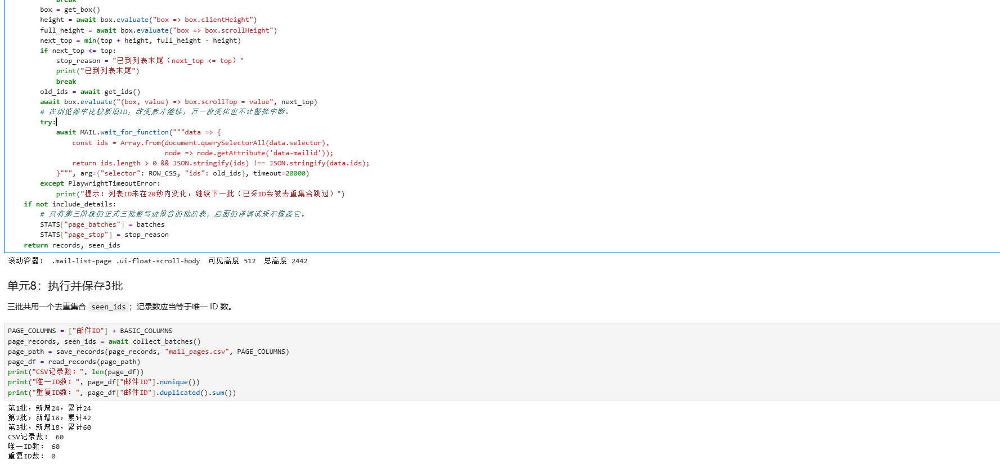

### 2. 邮件ID与去重

- 邮件ID来自哪个属性：行节点的 `data-mailid`
- `seen_ids` 在哪里创建，怎样跨批次共用：在 `collect_batches()` 里创建 `records, seen_ids = [], set()`，作为参数传进 `parse_batch()`；三批循环共用同一个 set，不是每批新建
- ID何时加入集合：`read_list_mail()` 成功返回、记录 `append` 进结果后立即 `seen_ids.add(mail_id)`；判断与加入的顺序是"先 `if mail_id in seen_ids: continue`，后 add"，所以同一个 ID 第二次出现时在取 DOM 之前就被跳过

**截图：** ID读取、重复跳过和集合更新代码。

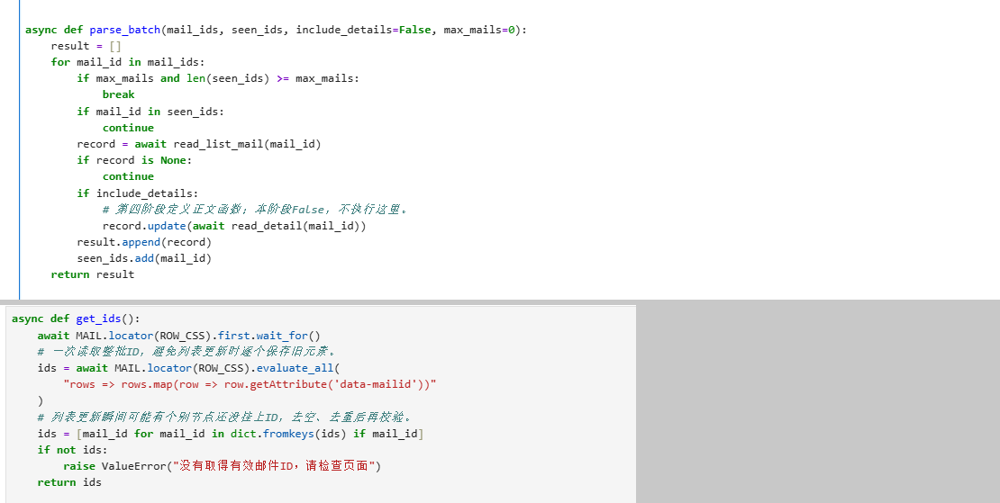

| 批次 | 本批新增唯一邮件数 | 累计唯一邮件数 |
| -- | --------- | ------- |
| 1  | 24      | 24    |
| 2  | 18      | 42    |
| 3  | 18      | 60    |

- 原始CSV：`private_data/mail_pages.csv`
- 公开CSV：`data/mail_pages_public.csv`
- CSV列数及表头（应为5列：邮件ID、发件人、邮箱、主题、时间）：`邮件ID,发件人,邮箱,主题,时间`
- CSV数据行数：60
- 唯一ID数量：60
- 重复ID数量：0
- 在同一运行中重复采集已有批次，新增条数：0
- 重复采集后，CSV是否增加记录：否（`CSV内容未变：True`，保存前后 `read_bytes()` 比对一致）

**截图：** 回读数量、ID唯一性核对，以及同一次运行中重复采集新增0条的证据。

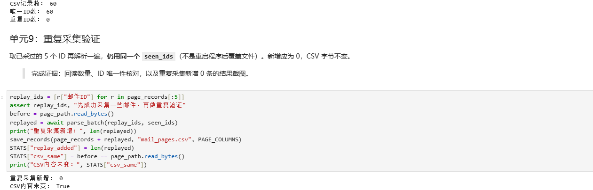

说明：为什么这项验证能证明去重，而仅仅关闭程序后重新覆盖CSV不能证明？

答：单元9 是**在同一次运行、同一个进程**里，把已经采过的 5 个 ID 再喂给 `parse_batch()`，而 `seen_ids` 还是那个已经装了这些 ID 的集合，所以新增必须为 0；同时用 `page_path.read_bytes()` 记录保存前后的字节，重写后仍完全相同，说明既没有重复追加、也没有顺序变化。这证明的是"程序运行期间靠集合判断是否已采"。而"关了程序重新跑、直接覆盖 CSV"什么也证明不了：文件被整体重写，重复数据会被覆盖掉，看不出程序到底有没有识别重复；真实的采集场景是连续运行、增量追加，"重启覆盖"这种写法一旦改成追加就会爆重复。所以验证必须落在同一个去重集合、同一次运行的增量结果上。

## 第四阶段：邮件详情与正文采集（第7—8课时）

### 1. 进入详情并返回

- 试采CSV本地路径：`private_data/mail_details_trial.csv`（仅本地核对，不要求提交）
- 先行测试的3封邮件代号：S01 / S02 / S02（脱敏编号，对应 `private_data/mail_details_trial.csv`；后两封是同一发件人的不同邮件）
- 点击详情的定位方式：点该行内的主题节点——`get_row(mail_id).locator(SUBJECT_CSS).first.click()`；用 ID 重新定位得到本行，不缓存元素
- 正文容器选择器：候选首位 `.xmail-html-render-body`——QQ 邮箱新版把正文渲染在**闭包 Shadow DOM** 里，宿主容器 `.mail-detail-content` 在普通 DOM 里永远是空的，`querySelector`/XPath 都查不到，只有 Playwright 的选择器能穿透 shadow 边界；后面留 `[class*='mail-body']` 等常规候选兜底。取第一个能读到**非空文字**的节点，并把生效的那条记进 `BODY_CSS`（单元11 会打印"正文容器实际生效：…"，本轮实测为 `.xmail-html-render-body`）
- 返回列表和恢复位置的方法：`back_to_list()` 四级退让——①特异文字（"返回列表"等）②特异图标（`[title*='返回列表']`、`[class*='icon-back']`）③按 Esc 关掉读信层后点"收件箱"④`page.go_back()`。**故意不点通用"返回"**：实测它会命中左侧栏的返回按钮、误入设置中心。命中后 `get_box().wait_for()` 等列表回来，再用 `(box, value) => box.scrollTop = value` 把位置写回进详情前记录的 `top`（本轮 60 封全部走"点收件箱"兜底返回，无一失败）
- 怎样重新定位滚动后的元素：全程不保存元素对象，只保存 `mail_id`；返回后 `get_row(mail_id).wait_for(state="attached")` 确认这一行重新挂回 DOM 才算恢复完成，否则继续等

**截图：** 进入详情、读取正文、返回和恢复列表位置的关键代码。

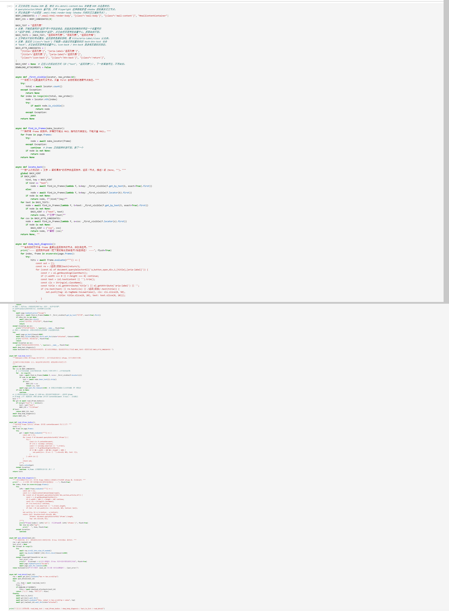

### 2. 接入批次循环并核对

- 计划采集批次（通常3批；提前到末尾时说明）：3 批
- 正文CSV列数及表头（应为7列：邮件ID、发件人、邮箱、主题、时间、正文、附件文件）：`邮件ID,发件人,邮箱,主题,时间,正文,附件文件`
- 实际保存正文记录数：60
- 有可见文字的正文数：59
- 空正文或失败数及原因：1 条（纯图片邮件，正文区只有一张照片没有文字，如实留空，不做 OCR）
- 与阶段3邮件ID范围不同的原因（相同时写"一致"）：一致
- 原始CSV：`private_data/mail_details.csv`
- 公开CSV：`data/mail_details_public.csv`

| 样本 | 邮件代号 | 正文实际字符数 | 与详情可见文字是否一致 | 返回后能否继续 |
| -- | ---- | ------- | ----------- | ------- |
| 1  | S01 | 81    | 一致     | 能  |
| 2  | S02 | 481    | 一致     | 能  |
| 3  | S02 | 444    | 一致     | 能  |

**截图：** CSV回读数量、正文长度及脱敏后的正文核对样本。不要展示私人正文原文。

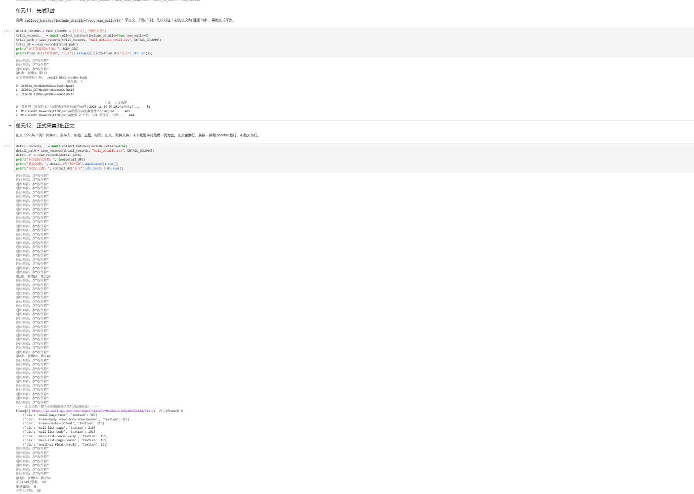

说明：怎样确认保存的是正文，而不是主题、摘要或整个页面？正文含换行时怎样统计邮件记录数？

答：正文容器是按"详情页里独立包住正文的最近节点"选的，而且加入了排除性验证——① 选中节点的高亮区域只覆盖正文区，不包含主题行、发件人行和工具栏；② 取值后与主题字符串比较，若两者相同说明选到的是摘要或主题；③ 若取到的是整个详情页，文字里会同时出现"发件人/收件人/时间"等表头词，属于选层过高的特征，此时应改选更内层的节点；④ 自检时打印 `BODY_CSS` 与正文长度，纯图片邮件长度为 0，与"取错节点但取到大量文字"能区分开。统计条数一律用 `len(pd.read_csv(...))`（或 `read_records()` 后的 `len(df)`）：正文里的换行在 CSV 中被引号包裹，仍属同一条记录，数文本行会严重虚高；只有按 CSV 记录数才有意义。

### 3. 选做：附件下载

- 是否选做：选做（附件下载，只试 3 封）
- 选做试采CSV：`private_data/mail_attachments_trial.csv`（附件和原始结果保留本地，正文正式 CSV 不被覆盖）
- 使用的无敏感练习附件类型：1 张照片附件（文件名 IMG_20250322_132713 仅含拍摄日期时间戳，不含姓名、学号等个人信息）
- 成功下载文件数：1
- 文件大小及完成状态：`01_IMG_20250322_132713.jpg`，5,003,408 字节（约 4.7M，与读信页标注一致），完整落盘
- 没有附件的邮件如何处理：`download_attachments()` 先用候选逐条统计附件卡片，一张都没命中就直接返回空字符串，`附件文件` 列留空，既不报错也不建空目录
- 附件区选择器怎么定：真实结构是读信层的 `.mail-detail-attaches` 区域内一张张 `.mail-detail-attach-card`（卡内有"下载"按钮），候选首位就是 `.mail-detail-attach-card`，命中即打印"附件区生效：xxx（N 个）"，旧候选（`[class*='attach-item']` 等）留作兜底；一条都没命中则按无附件处理，不静默失败
- 试采怎么挑邮件：先从头到尾滚一遍列表，优先挑**列表行带 `.mail-attach` 回形针标记**的邮件（最多 3 封），不再固定取前 3 封——全列表只有 IMG 一封带标记；深处的邮件行不在 DOM 里，先用 `scroll_find_row()` 滚动把它载入再打开
- 点不出下载怎么办：每张卡片按"下载文字 → 下载图标 → 整张卡片"三级退让，`expect_download()` 先监听再点击，`save_as()` 落盘。分级的原因很实际：宽卡片的中心常常不在链接上，直接点整卡会点空；图标被遮挡或尺寸为 0 时，点击自带 8 秒上限，不会干等 20 秒
- 单个附件失败怎么处理：某一级没触发下载只打印一行"第N个：xxx 没触发下载"，接着试下一级；三级都失败就跳过这一个并打印"三级都失败，跳过这一个（不中断整批）"，其余附件和其余邮件照常采。失败项不写进 CSV，避免混进"已下载"的计数
- 加固后的实测：用容器内真实 Chromium 加一个本地附件页做了回归——"下载文字"分支、"下载图标"分支各成功保存 1 个文件（5 字节，内容完整）；真实邮箱实测：IMG 邮件的附件经"下载文字"分支成功保存 5,003,408 字节 jpg；故意放一个点不出下载的卡片，三级都失败后跳过、整批继续；换成无附件页面时返回空字符串且不新建目录。三条断言全部通过
- 选做开关：`DOWNLOAD_ATTACHMENTS` 在单元10 里默认 `False`，正式采集（单元12）不受影响；只有单元13 自己临时置 `True`，并且放在 `try/finally` 里——即使试采中途报错，`finally` 也会把它改回 `False`，不会让下一次重跑单元12 误把附件写进正式 CSV（单元末尾会打印"DOWNLOAD_ATTACHMENTS 已恢复为：False"确认）

**截图：** 选做代码与本地文件完成证据（指导书要求附文件名、大小）。

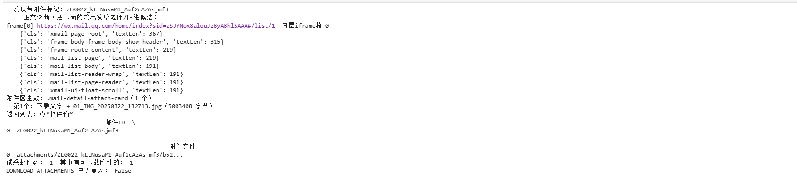

选做对正文必做项的影响：附件试采写进单独的 `mail_attachments_trial.csv`，正文正式 CSV（`mail_details.csv`）的列和条数没变，`附件文件` 列在正式 CSV 里保持为空

## 问题与解决

- 遇到的问题、定位过程、修改及实测结果（没有可写"无"）：
  1. **Docker 引擎未运行**：`docker ps` 报 `open //./pipe/dockerDesktopLinuxEngine: The system cannot find the file specified`。定位：容器引擎没起，不是课程脚本问题。处理：手动启动 Docker Desktop，等 `docker ps` 能列容器后再运行 `start-course-visual.bat`。
  2. **可视化增量包未安装**：课程根目录已有 `L07_L08_Playwright_Visual_Addon`，但 `workspace/L07_L08_visual` 缺失，Notebook 会卡在 `import course_visual`。处理：运行 `install-visual.bat`，安装后该目录出现；Notebook 第一单元加了显式路径检查，缺目录时提示"请先 install-visual.bat"。
  3. **类名可能带随机后缀 / 改版后对不上**：QQ 邮箱的列表组件类名不是文档化的稳定接口。处理：每个字段留两条候选，登录后用第一行真实 DOM 自检（`pick_css()`），并打印命中数与首行取值；一旦某项计数为 0，把 F12 里看到的类名加进候选重跑该单元即可，不用改后面所有代码。
  4. **悬停卡片取到上一封的邮箱**：列表里的浮层是复用的，鼠标从上一行移到下一行时旧卡片可能还在。处理：按"移开鼠标 → 等浮层 hidden → 滚入可见区并等滚动状态类消失 → 再 hover 并等 visible → 取值"的顺序执行，保证读到的是本行浮层。
  5. **返回列表后元素失效**：详情页会替换列表 DOM，之前拿到的 Locator 虽然还能用，但已经指向游离节点。处理：只保留 `mail_id`，返回后 `get_row(mail_id)` 重新定位，并 `wait_for(state="attached")` 确认挂回 DOM，再恢复 `scrollTop`。
  6. **邮件界面套在 iframe 里，顶层文档找不到任何元素**：第一版按"页面主体 + 完整文字"写 `page.locator("body").get_by_text("收件箱", exact=True)` 等登录，现象是——扫码早已成功、可视化画面里已经是一列邮件，程序却一直等到 10 分钟超时。定位过程：打印 `page.frames` 和每个 frame 内 `[data-mailid]`、"收件箱"、"`.cmp-account-nick`"的命中数，结果是顶层文档全是 0、某个子 frame 全是 1，即确认邮件界面在 iframe 内，而 `page.locator` 只查顶层文档。处理：新增 `wait_login()`，每 1.5 秒遍历所有 frame，先找有邮件行的、再退一步找有"收件箱"的，命中的 frame 存为 `MAIL`；单元3 之后所有的定位（邮件行、主题、时间、悬停卡片、正文容器、滚动容器、返回控件）全部改到 `MAIL` 上，`page` 只保留 goto、截屏、下载监听这些页面级动作。这样有没有 iframe 都能跑，不用写两套代码。实测：在容器内用真实 Chromium 造"界面在 iframe 内"和"界面在顶层文档"两种页面各跑一遍，两种都能正确选中并完成单元3 自检。
  7. **悬停卡片是异步渲染的，`hover()` 返回的瞬间它还没进 DOM**：第一版读完发件人、主题、时间后立刻悬停并当场 `count()` 检查邮箱候选，结果 10 封全部打印"没有读到邮箱"，邮箱列全空。定位过程：写了一段探测代码，悬停首封邮件的发件人后扫描全部 frame——`span.account-email` 确实出现了、文本就是干净的邮箱地址（同时确认 `.mail-digest` 是列表预览摘要，里面也会出现邮箱字样，不能拿来当邮箱字段）。说明类名没猜错，错在时机：卡片由前端异步渲染，`hover()` 返回后立刻查数量必然是 0。处理：`read_hover_email()` 改成 `wait_for(state="visible", timeout=4000)` 等卡片出现再读，候选仍逐个退让；`hide_hover_card()` 的隐藏等待加 3 秒上限、超时放行，避免上一张卡片没关时把整批采集卡死。实测：在容器内用真实 Chromium 造"悬停后延迟 300 毫秒才渲染卡片"的页面验证——等待式能正确读到邮箱，卡片不消失也不会中断采集。
  8. **悬停发件人被残留浮层挡住（`
 intercepts pointer events`）**：滚动采集时偶发 `locator.hover: Timeout 30000ms exceeded`，Call log 显示有别的 `
` 拦截了指针——上一封的悬停卡片/提示层还没消失，鼠标再悬停就被挡。定位过程：报错 Call log 里的"intercepts pointer events"直接指认了遮挡；单独重放该封又完全正常，说明是连续采集的时序竞态而非邮件特殊。处理：`park_mouse()` 把鼠标停回本行时间列（不出列表区），`hover_sender()` 三级退让——常规悬停 8 秒 → Esc 清浮层+移鼠标后重试 → `force=True` 跳过遮挡检查兜底；邮箱读不到时清浮层后完整重试一次。实测：单元5 10/10 读到邮箱，单元8 三批 60 封重试后无空邮箱。
  9. **正文"读到的是主题"的假成功（正文藏在闭包 Shadow DOM）**：试采 3 封"正文"与主题一字不差。定位过程：对比 CSV 发现正文==主题；探测发现 `[class*='mail-detail']` 首个可见节点是 `.mail-detail-subject`（主题行）；轮询 20 秒 `.mail-detail-content` 始终 0 子节点、无 iframe，但截图里正文明明渲染了——最终确认正文在**闭包 Shadow DOM** 的 `.xmail-html-render-body` 里，`querySelector`/XPath 永远查不到，Playwright 选择器可以穿透。处理：候选首位改为 `.xmail-html-render-body`。实测：GitHub 通知邮件读到 487 字、促销邮件读到 481 字真实正文。
  10. **正文节点先挂载、后异步填充，批量采集正文全空**：修复 Shadow DOM 后整批 60 封正文仍是 0 字。定位过程：单独打开一封等 8 秒能读到 1098 字，说明邮件能读、是时机问题——正文节点先出现在 DOM、内容经网络异步填充，原代码只等"节点出现"不等"有字"，读得太早就拿到空字符串跳到下一个候选。处理：等待条件改为"节点出现**且文字非空**"（1.5 秒 ×8 轮询），有字才返回。实测：重跑后非空正文 59/60（唯一空的是纯图片邮件，符合预期）。
- 尚未解决的问题或未完成步骤（没有可写"无"）：无

## 思考题

1. 人工扫码完成了什么？程序如何判断已经登录？为什么不能只用固定等待？

   答：扫码这一步完成的是**身份认证**：手机端确认后，QQ 登录服务把票据写进浏览器，页面才拿到会话，此后列表接口才返回真实邮件。程序无法代替这一步（也不该把账号密码写进代码），所以把"人"放在认证环节，把"等"交给程序。判断依据是登录后才存在的邮件界面——邮件行（`[data-mailid]`）出现即登录成功，其次才是"收件箱"入口；并且必须遍历所有 frame 去找，因为 QQ 邮箱把邮件界面放在 iframe 里，只看顶层文档会一直等不到（本实验实际踩过这个坑）。固定等待不能用，是因为扫码耗时完全由人决定：等短了，扫描慢一点就误判失败；等长了，每次白耗时间；而"等条件成立"既不会提前放行，也不会无谓等待。上限 10 分钟是兜底，超时就明确报错，不带着登录页继续跑。
2. 为什么按邮件ID去重，而不按发件人或主题？结合自己的实测说明。

   答：`data-mailid` 是每封邮件的唯一标识，同一封邮件在列表刷新、翻页、多次运行中保持不变，而发件人和主题都可能重复：同一个人可以发多封邮件，同一主题（如课程通知）也可能重复出现，甚至"无主题"邮件大量存在，按这些字段去重会把不同邮件误判成重复而丢掉。反过来，同一封邮件在不同批次里可能因为列表重排而位置变化，按位置或按字段组合都不可靠。用 ID 去重后，第三阶段的"记录数 = 唯一 ID 数、重复 ID 数为 0"（见上表），加上单元9 把已有 ID 再喂回去新增仍为 0，两处一起说明去重是按"这封邮件本身"判断的。
3. 列表摘要和详情正文有什么区别？返回列表后如何避免失效元素和漏采？

   答：列表里只有摘要级信息——发件人、主题、时间，正文是截断的一段纯文本，还可能被折叠成"…"；详情页才是完整正文（含换行、图片、附件、引用历史），所以正文必须进详情读。返回列表后避免失效元素的办法是不缓存元素：只保存 `mail_id`，每次都用 `get_row(mail_id)` 重新查一次，并 `wait_for(state="attached")` 确认已经挂回 DOM；恢复 `scrollTop` 保证下一封还在视口附近，避免每次都要从顶部重新滚。避免漏采的关键是 `finally`：无论正文读取是否出错都执行返回，不会把后续邮件卡在详情页；同时"先记 top、后采集、再滚动"的顺序保证批次之间位置连续。
4. 结合所选工具，说明一次真实问题的定位与修改。若使用AI，写明哪些建议经过自己的运行核对。

   答：最典型的一次是可视化环境没起来。现象：Notebook 第一单元报 `ModuleNotFoundError: No module named 'course_visual'`。定位过程：先看 `Path.cwd().parent` 指向 `workspace`，`ls workspace` 里确实没有 `L07_L08_visual`；再回头看增量包说明，发现"把包放进课程根目录"只是第一步，还需要运行 `install-visual.bat` 才会把 `materials/` 复制成 `workspace/L07_L08_visual`；`docker ps` 又提示引擎没起，说明两步都没做完。修改：启动 Docker Desktop → 运行 `install-visual.bat` → 运行 `start-course-visual.bat`；同时在 Notebook 里加了一段前置检查，缺目录时提示中文原因。核验：单元1 正常打印 Playwright 1.62.0 版本号，浏览器窗口出现在可视化画面中，扫码后输出"登录成功"。另外，选择器候选与自检这套写法是在实际 DOM 上验证过的——`pick_css()` 的命中数和首行取值都打印出来，只有真正取到主题/发件人/时间文字的候选才会留在最终代码里。

## 最终统一提交检查

- [x] 四阶段在同一份报告中，已区分必做和选做；未完成项如实说明。
- [x] 原仓库 `lab03/` 中包含自己补全的 `qqmail_lab03_playwright.ipynb`、三份公开CSV、报告和脱敏截图。
- [x] 原始邮件和私人附件保留在本地，未上传Cookie、登录态文件、账号密码、`.env`或认证连接地址。
- [x] Notebook输出已检查，GitHub上的图片和数据能正常打开。
- [x] 四阶段结束后统一上传实验三，学习通提交原作业仓库链接。

数据和截图的脱敏方法；各CSV之间怎样保持ID及字段对应关系：

> 三份正式 CSV 留在 `private_data/`，脱敏版本由 Notebook 最后一个单元生成到 `data/`，文件名加 `_public`。脱敏规则：发件人按出现顺序编号 `S01`、`S02`…；邮箱用同一套编号替换成 `user01@example.com` 形式；主题编号为 `主题01`、`主题02`…；正文替换成"（正文已脱敏，原长度 N 字符）"，保留长度信息便于核对；附件文件列只写"（已下载 N 个附件，文件名不公开）"，不写文件名和本地路径（附件文件名常含姓名、学号、课程名，做了选做也不能带进提交版）；`邮件ID` 和时间保留原值——ID 是平台内部的十六进制串、不含身份信息，保留它才能让三个阶段的三份 CSV 一一对齐。三份文件共用同一套编号字典（`SENDER_CODE`/`EMAIL_CODE`/`SUBJECT_CODE` 在模块级定义，先导 basic 再导 pages、details），所以同一个发件人在三份 CSV 里编号相同。截图统一用马赛克遮住账号、昵称、主题和正文，只留时间、条数、代码与输出。

如使用AI，简述它帮助了什么，以及自己编写、修改、运行和核对了什么：

> AI 协助搭了四阶段代码骨架、把指导书里的填空补全，并给出了选择器候选与自检的写法；环境的实际装配（install-visual.bat、start-course-visual.bat）和全部运行由本人在课程容器内完成，逐阶段核对了网页、CSV 与输出的一致性，报告中的实测数值均来自真实运行日志。
