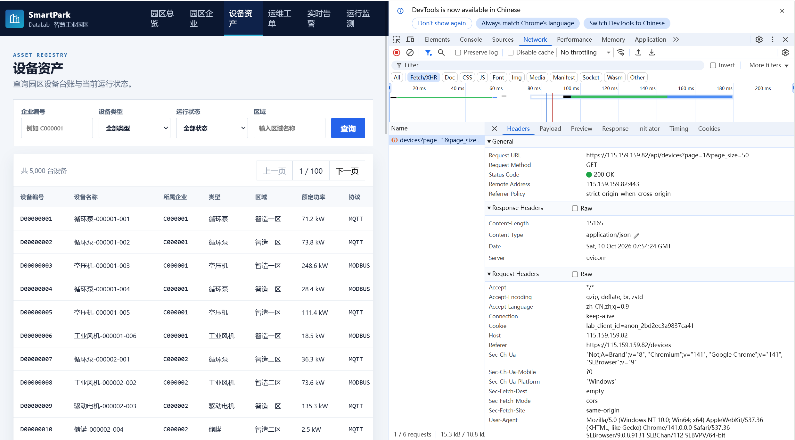
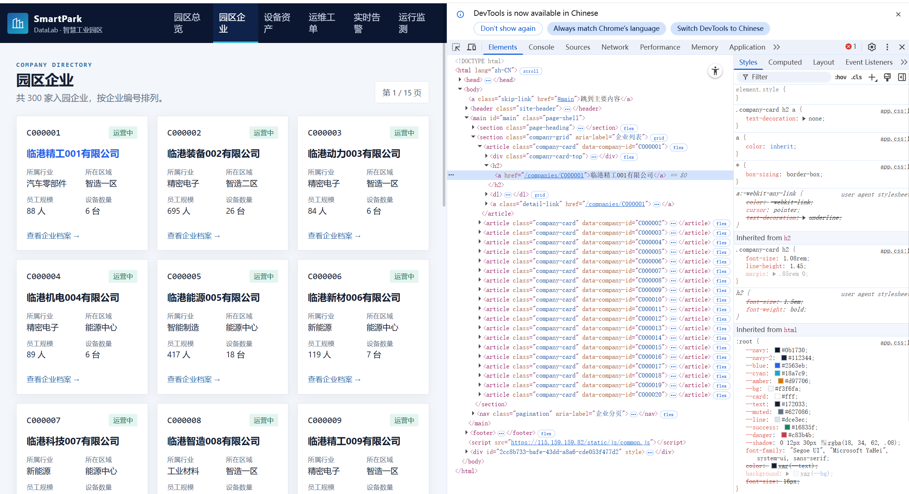
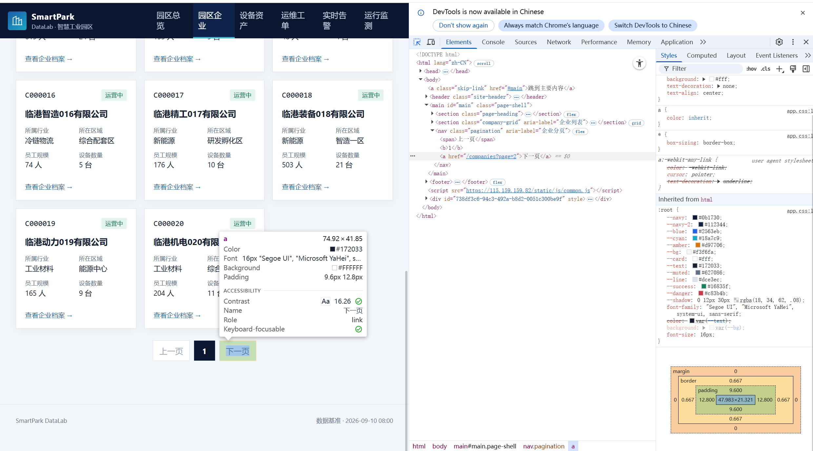
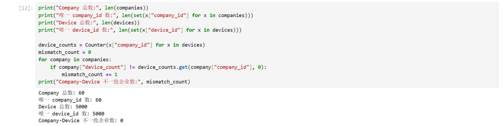

# Lab 1 实验报告

## 学生信息

- **姓名：沈昊辉**
- **学号：112404260123**
- **班级：数据1241**
- **GitHub 用户名：**05justin-hub
- **仓库地址：**[05justin-hub/bigdata-collection-labs-112404260123](https://github.com/05justin-hub/bigdata-collection-labs-112404260123)

> 文件位置：`lab01/REPORT.md`  
> 完整代码保存在 `lab1_html_api.ipynb`。  
> 本报告只填写关键发现、关键代码、结果和指定截图，**不要把整份 Notebook 复制进来**。

---

# 任务 1：判断数据加载方式

## 1.1 Device：判断动态加载并找到 API

### 判断结果

- 页面：`/devices`
- 数据加载方式：`动态加载`
- 判断依据：

在「右键 → 查看网页源代码」中按 `Ctrl + F` 搜索页面上显示的设备名称（如“循环泵-000001-001”），源代码中找不到任何设备记录，说明数据不随初始 HTML 返回；打开 F12 → Network → Fetch/XHR 刷新页面后，找到了返回设备列表 JSON 的请求 `/api/devices`。

### API 信息

- Request URL：<https://115.159.159.82/api/devices?page=1&page_size=50>
- Request Method：GET
- Query 参数：`page=1`（当前页码）、`page_size=50`（每页条数）

### 【截图 1】Device API 发现证据

文件名：

```text
images/01_device_api.png
```

插入：

```markdown

```

---

## 1.2 Company：判断静态加载

- 页面：`/companies`
- 数据加载方式：`静态加载`
- 判断依据：

使用「右键 → 查看网页源代码」后，按 `Ctrl + F` 搜索页面中真实显示的企业名称（如“临港精工001有限公司”），可以在源代码中直接搜到该企业名称及其完整记录（`<article class="company-card" data-company-id="C000001">`），说明企业数据随初始 HTML 一起返回，可直接 requests + BeautifulSoup 解析。

### 【截图 2】Company 静态加载证据

文件名：

```text
images/02_company_source.png
```

插入：

```markdown

```

---

# 任务 2：Device API 分页采集

## 2.1 API 分页结构

从第一页 JSON 响应中实际观察到的字段：

| 含义   | JSON 字段 |
| ---- | ------- |
| 当前页  | `page` |
| 每页条数 | `page_size` |
| 设备总数 | `total` |
| 设备列表 | `items` |

---

## 2.2 关键代码

```python
# 从第一页响应中读取分页信息
total = data["total"]
page_size = data["page_size"]

total_pages = (total + page_size - 1) // page_size

devices = []

for page in range(1, total_pages + 1):
    r = requests.get(
        api_url,
        params={
            "page": page,
            "page_size": page_size
        },
        timeout=10
    )

    page_data = r.json()
    page_items = page_data["items"]
    devices.extend(page_items)
```

---

## 2.3 采集结果

- 每页条数：50
- 设备总数：5000
- 程序计算得到的总页数：100
- 最终采集设备数：5000
- 唯一 `device_id` 数：5000

回答：

> 为什么总页数应由 API 返回的 `total` 和 `page_size` 计算，而不是直接在代码里写死？

答：写死页数的前提是数据总量永远不变，一旦平台新增或删除设备，写死的页数要么漏采、要么发出大量空请求。用 `(total + page_size - 1) // page_size` 由接口返回的 `total` 和 `page_size` 动态计算，无论数据规模怎么变、每页条数怎么调，代码都不需要修改，采集程序更健壮、可复用。

---

# 任务 3：Company HTML 解析

## 3.1 企业记录 Selector

- 企业记录 selector：`article.company-card`
- 第 1 页企业记录数：20

说明为什么选择这个 selector：

- 主要使用了 `id / class / data-* / 父子层级` 中的哪一种？——主要使用 **class**（`company-card`），并配合该节点自带的 **data-\*** 属性（`data-company-id`）提取企业编号。
- 是否参考过浏览器 Copy selector 或 AI？——参考过浏览器 Copy selector，但它给出的是带长串 `nth-child` 的绝对路径，对页面结构变化很敏感。
- 最终为什么采用现在这个写法？——每条企业记录都是 `<article class="company-card">`，class 名语义明确、在页面中唯一、层级浅，用 `article.company-card` 两个词就能精确定位全部记录，比 Copy selector 的长路径更短、更稳定。

---

## 3.2 关键代码

```python
cards = soup.select("article.company-card")

card = cards[0]

company_id = card.get("data-company-id")
name = card.select_one("h2 a").get_text(strip=True)
status = card.select_one("span.badge").get_text(strip=True)
```

行业、区域、设备数量使用 `dt/dd` 结构后，请写出你最终如何得到：

```python
details = {}
for item in card.select("dl > div"):
    key = item.select_one("dt").get_text(strip=True)
    value = item.select_one("dd").get_text(strip=True)
    details[key] = value

industry = details["所属行业"]
zone = details["所在区域"]
device_count = int(details["设备数量"].replace("台", "").strip())
```

---

## 3.3 字段来源说明

1. 字段：`company_id`
   - 来自：`HTML 属性`
   - 使用的方法：企业卡片节点 `<article>` 自带 `data-company-id` 属性，用 `card.get("data-company-id")` 直接读取，比解析文本更可靠。
2. 字段：`device_count`
   - 来自：`文本`
   - 使用的方法：先在卡片内用 `dl > div` 把 `dt/dd` 转成字典，取“设备数量”对应的文本（如 `"6 台"`），再用 `.replace("台", "").strip()` 清洗后用 `int()` 转为整数。

---

# 任务 4：Company “下一页”分页

## 4.1 下一页元素

- “下一页” selector：`nav.pagination a`（再按链接文本过滤出含“下一页”的那个 `<a>`）
- 第 1 页 `href` 示例：`/companies?page=2`

### 【截图 3】Company “下一页”元素

文件名：

```text
images/03_company_next.png
```

插入：

```markdown

```

---

## 4.2 关键代码

```python
next_link = None
for a in soup.select("nav.pagination a"):
    if "下一页" in a.get_text(" ", strip=True):
        next_link = a
        break

next_href = next_link.get("href")

next_url = urljoin(
    current_url,
    next_href
)
```

再用 2～3 句话说明：

> 你的程序如何完成“当前页 → 找下一页 href → 请求下一页 → 再解析”的循环？

答：程序把“请求当前页 → 解析本页 20 条企业 → 在分页栏找到含‘下一页’文本的 `<a>` → 用 `urljoin` 拼出下一页绝对地址”封装成一个循环，循环内每次用新的 `current_url` 重复上述步骤，直到取满 3 页（或找不到“下一页”链接）为止。实践中发现：从第 2 页开始“上一页”也变成了 `<a>` 链接，若直接取分页栏的第一个 `<a>` 会翻回第 1 页，所以必须按链接文本“下一页”过滤。

---

## 4.3 三页采集结果

| 页码     | 企业数 |
| ------ | --: |
| 1      | 20 |
| 2      | 20 |
| 3      | 20 |
| **合计** | 60 |

- 唯一 `company_id` 数：60

---

# 任务 5：结果验证

## 5.1 最终结果

| 检查项                   | 结果 |
| --------------------- | -: |
| Company 总数            | 60 |
| 唯一 `company_id`       | 60 |
| Device 总数             | 5000 |
| 唯一 `device_id`        | 5000 |
| Company–Device 不一致企业数 | 0 |

### 【截图 4】最终验证结果

文件名：

```text
images/04_validation.png
```

插入：

```markdown

```

---

## 5.2 一致性检查关键代码

```python
from collections import Counter

device_counts = Counter(
    x["company_id"] for x in devices
)

mismatch_count = 0

for company in companies:
    cid = company["company_id"]
    expected = company["device_count"]
    actual = device_counts.get(cid, 0)

    if expected != actual:
        mismatch_count += 1
```

回答：

> 为什么 `status_code == 200` 仍然不能说明“数据已经采集正确”？

答：200 只代表服务器成功返回了一次响应，不代表返回的内容就是我们要的完整数据。可能返回的是空列表、错误提示页、被截断的半页数据，或者分页参数写错导致只采到第 1 页。真正可靠的判断要靠对数据本身的校验：数量是否符合预期、ID 是否唯一、跨数据源（Company 页面的 `device_count` 与 Device API 统计值）是否一致。

---

# 任务 6：保存采集结果

确认已经生成：

```text
data/companies.json
data/devices.json
```

填写：

- `companies.json`：`已生成`
- `devices.json`：`已生成`

---

# 实验结论

答：静态页面的数据随初始 HTML 返回，用 requests 取回文本后交给 BeautifulSoup，按 CSS Selector 定位记录、逐字段提取；动态页面的数据在源代码里搜不到，需要先用 Network 的 Fetch/XHR 找到底层 API，再直接请求 API 拿结构化 JSON。API 分页由接口返回的 total 和 page_size 算出总页数、按 page 参数循环，规律固定；HTML“下一页”分页则要在每页 DOM 里重新找“下一页”链接、用 urljoin 拼接后跟进，需注意“上一页”也是链接，要按文本过滤。验证上我用了三类方法：核对采集数量是否达到目标、检查 company_id/device_id 是否无重复、用 Counter 统计各企业设备数并与 Company 页面的 device_count 逐家比对（不一致企业数为 0），全部通过后才把结果保存为 JSON。
